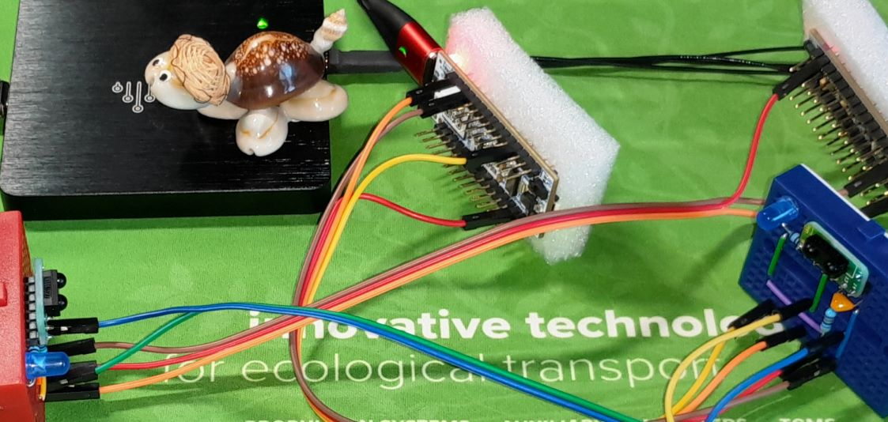
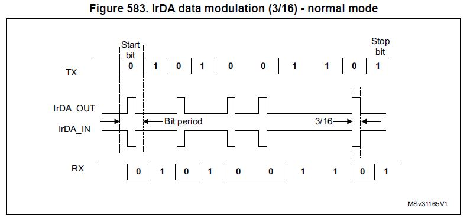
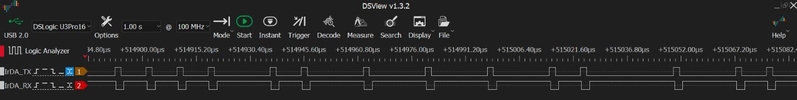
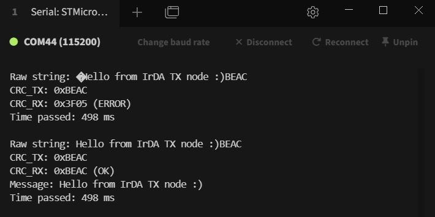

# IrDA (Infrared Data Association) SIR (Serial/Slow/Standard Infrared) demo [STM32G431KB]

Me playing with IrDA SIR data transfer and handling physical layer errors. Here CRC is deployed. Other methods left to my Students. Also half-duplex communication, ACKs, and retransmissions left to my Students. Not to be confused with NEC IR. The latter is also on my agenda. Note that STM32s natively support IrDA - the encoder/decoder can be configured under the UART peripheral.

In this repo the RX part is demonstrated. The accompanying TX node is available [here](https://github.com/ufnalski/irda_demo_tx_node_l432kc).

# Missing files?
Don't worry. Just open the .ioc file in STM32CubeMX and hit the GENERATE CODE blue bar. Then open the project in STM32CubeIDE for Visual Studio Code and build it.

# BOM
* [TFDU4101 Infrared Transceiver Module (SIR, 115.2 kbit/s) for IrDA Applications](https://www.vishay.com/docs/81288/tfdu4101.pdf) (Vishay)

# Readings
* [IrDA](https://en.wikipedia.org/wiki/IrDA) (Wikipedia)
* [Infrared Data Association Serial Infrared Physical Layer Link Specification](https://web.mit.edu/rec/iap/mirror/irda/IrPHY_1_2.PDF) (MIT)
* [CRC16-CCITT](https://srecord.sourceforge.net/crc16-ccitt.html) (SourceForge)
* [Infrared Data Communication According to IrDA Standard](https://www.vishay.com/docs/82513/physicallayer.pdf) (Vishay)
* [IRDC transceivers](https://www.vishay.com/en/ir-transceivers/) (Vishay)
* [RM0440 Reference manual STM32G4 series advanced Arm-based 32-bit MCUs](https://www.st.com/resource/en/reference_manual/rm0440-stm32g4-series-advanced-armbased-32bit-mcus-stmicroelectronics.pdf) (STMicroelectronics)

# Further inspirations
* [Low Power Infrared Energy Meter Monitor](https://hackaday.io/project/195440-low-power-infrared-energy-meter-monitor) (Hackaday)
* [Smartmeter Reader for Landis + Gyr E450 / ISKRA AM550](https://github.com/canique/smartmeter-reader)
* [Canique Smartmeter Sense - Wireless battery powered smart meter interface](https://www.canique.com/smartmeter-sense) (Canique)
* [IEC 62056](https://en.wikipedia.org/wiki/IEC_62056) (Wikipedia)

# Call to action
Create your own [home laboratory/workshop/garage](http://ufnalski.edu.pl/control_engineering_for_hobbyists/2026_festiwal_nauki/Festiwal_Nauki_2026.pdf)! Get inspired by [ControllersTech](https://www.youtube.com/@ControllersTech), [DroneBot Workshop](https://www.youtube.com/@Dronebotworkshop), [Andreas Spiess](https://www.youtube.com/@AndreasSpiess), [GreatScott!](https://www.youtube.com/@greatscottlab), [bitluni's lab](https://www.youtube.com/@bitluni), [ElectroBOOM](https://www.youtube.com/@ElectroBOOM), [Phil's Lab](https://www.youtube.com/@PhilsLab), [atomic14](https://www.youtube.com/@atomic14), [That Project](https://www.youtube.com/@ThatProject), [Paul McWhorter](https://www.youtube.com/@paulmcwhorter), [Max Imagination](https://www.youtube.com/@MaxImagination), [Nikodem Bartnik](https://www.youtube.com/@nikodembartnik), [Stuff Made Here](https://www.youtube.com/@StuffMadeHere), [Mario's Ideas](https://www.youtube.com/@marios_ideas), [Aaed Musa](https://www.aaedmusa.com/), [Haase Industries](https://www.youtube.com/@h1tec), [Marcin Plaza](https://www.youtube.com/MarcinPlaza), and many other professional hobbyists sharing their awesome projects and tutorials! Shout-out/kudos to all of them! Promote [README-driven learning](https://pe.org.pl/wp-content/uploads/2026/06/10_15199_48_2026_06_9.pdf).

> [!WARNING]
> IrDA SIR data transfer - do try this at home :grey_exclamation:

230+ challenges to start from: [Control Engineering for Hobbyists at the Warsaw University of Technology](http://ufnalski.edu.pl/control_engineering_for_hobbyists/Control_Engineering_for_Hobbyists_list_of_challenges.pdf).

Stay tuned!

0xBU
